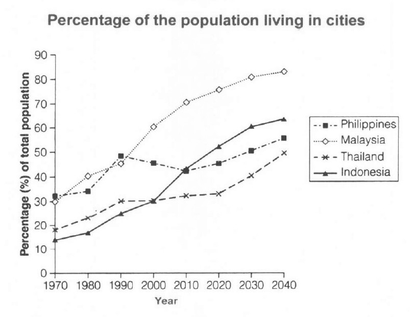

# Cambridge IELTS 18 Academic · Test 1 · Writing

[PDF page 29](<../../Cambridge IELTS 18 Academic.pdf#page=29>) – [PDF page 30](<../../Cambridge IELTS 18 Academic.pdf#page=30>)

Task 1 of 2

Population living in cities

You should spend about 20 minutes on this task.

The graph below gives information about the percentage of the population in four Asian countries living in cities from 1970 to 2020, with predictions for 2030 and 2040.

Summarise the information by selecting and reporting the main features, and make comparisons where relevant.

Write at least 150 words.

Task 2 of 2

The aim of science

You should spend about 40 minutes on this task.

Write about the following topic:

The most important aim of science should be to improve people’s lives.

To what extent do you agree or disagree with this statement?

Give reasons for your answer and include any relevant examples from your own knowledge or experience.

Write at least 250 words.
