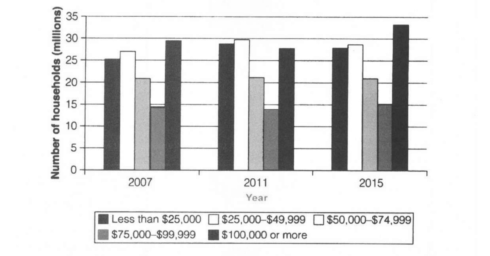

# Cambridge IELTS 18 Academic · Test 2 · Writing

## [PDF page 52](<../../Cambridge IELTS 18 Academic.pdf#page=52>)

WRITING

WRITING TASK 1

You should spend about 20 minutes on this task.

The chart below shows the number of households in the US by their annual
income in 2007, 2011 and 2015.

Summarise the information by selecting and reporting the main features, and
make comparisons where relevant.

Write at least 150 words.

## [PDF page 53](<../../Cambridge IELTS 18 Academic.pdf#page=53>)

WRITING TASK 2

You should spend about 40 minutes on this task.

Write about the following topic:

Some university students want to learn about other subjects in addition to
their main subjects. Others believe it is more important to give all their time
and attention to studying for a qualification.

Discuss both these views and give your own opinion.

Give reasons for your answer and include any relevant examples from your own
knowledge or experience.

Write at least 250 words.
