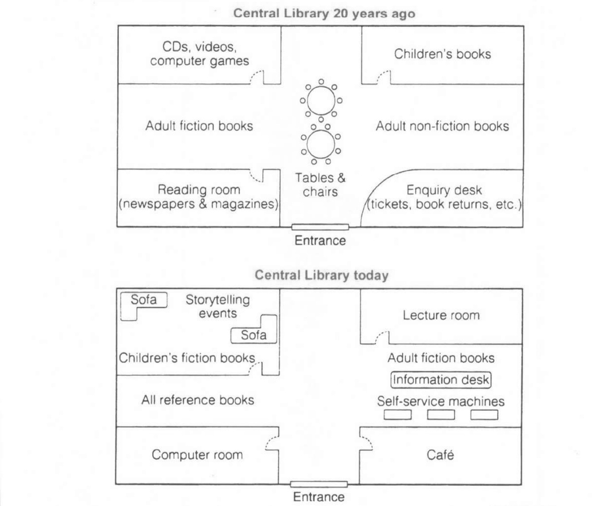

# Cambridge IELTS 18 Academic · Test 3 · Writing

## [PDF page 75](<../../Cambridge IELTS 18 Academic.pdf#page=75>)

WRITING

WRITING TASK 1

You should spend about 20 minutes on this task.

The diagram below shows the floor plan of a public library 20 years ago and
how it looks now.

Summarise the information by selecting and reporting the main features, and
make comparisons where relevant.

Write at least 150 words.

## [PDF page 76](<../../Cambridge IELTS 18 Academic.pdf#page=76>)

WRITING TASK 2

You should spend about 40 minutes on this task.

Write about the following topic:

In many countries around the world, rural people are moving to cities, so the
population in the countryside is decreasing.

Do you think this is a positive or a negative development?

Give reasons for your answer and include any relevant examples from your own
knowledge or experience.

Write at least 250 words.
