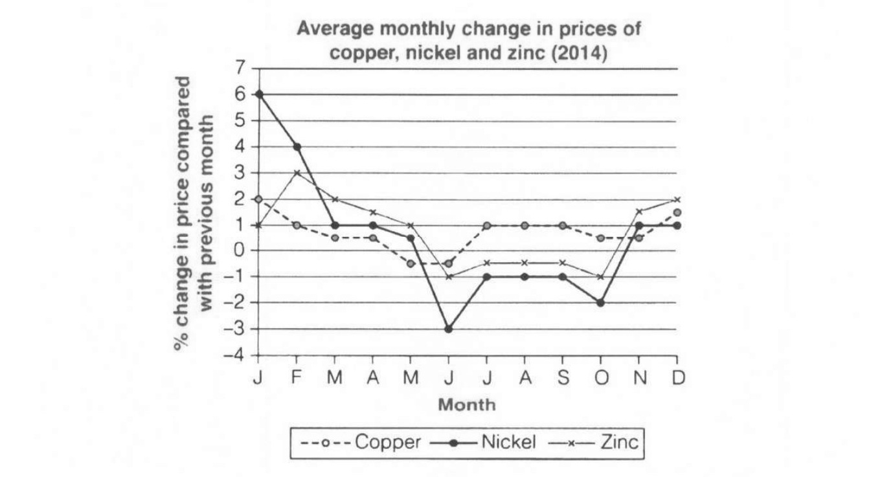

# Cambridge IELTS 18 Academic · Test 4 · Writing

## [PDF page 96](<../../Cambridge IELTS 18 Academic.pdf#page=96>)

WRITING

WRITING TASK 1

You should spend about 20 minutes on this task.

The graph below shows the average monthly change in the prices of three
metals during 2014.

Summarise the information by selecting and reporting the main features, and
make comparisons where relevant.

Write at least 150 words.

## [PDF page 97](<../../Cambridge IELTS 18 Academic.pdf#page=97>)

WRITING TASK 2

You should spend about 40 minutes on this task.

Write about the following topic:

In many countries, people are now living longer than ever before. Some
people say an ageing population creates problems for governments. Other
people think there are benefits if society has more elderly people.

To what extent do the advantages of having an ageing population outweigh
the disadvantages?

Give reasons for your answer and include any relevant examples from your own
knowledge or experience.

Write at least 250 words.
